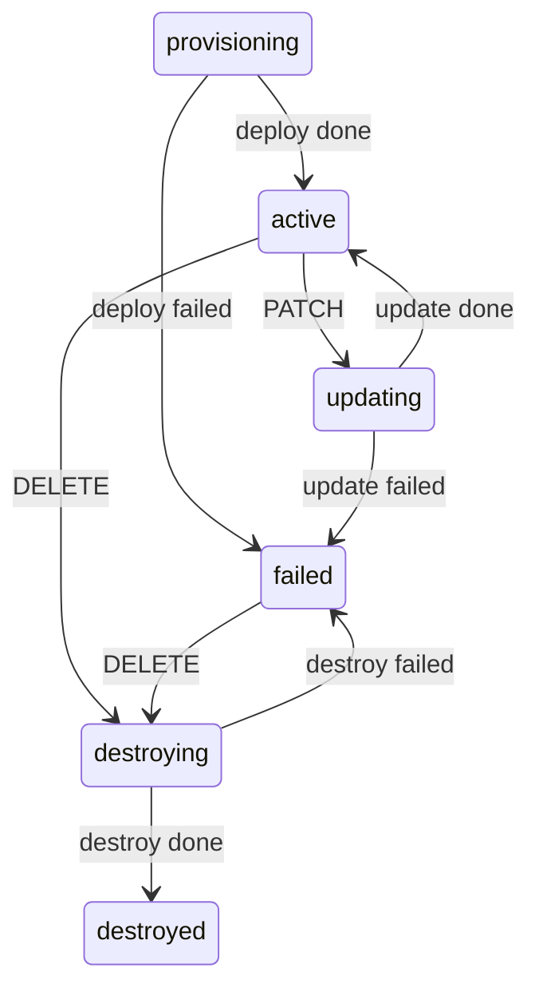

# Tenant Provisioning Control Plane

This is my take on the tenant provisioning assignment. Tenants are provisioned
asynchronously: the API records the tenant and pushes a task to a queue, a
worker picks it up, simulates the work and reports progress back. The tenant
status follows the task outcomes.

## How it fits together

```
client --> HTTP API ----(1 txn: tenant + task)----> MongoDB
                 ^                                    |
                 |                              outbox sweeper
                 |                                    v
           update consumer <-- SQS updates      SQS tasks queue
                 ^                                    |
                 |                                    v
                 +------------ worker simulator <-----+
                   (in_progress, then done/failed)
```

- `app/` - the control plane. One process running the HTTP API plus two
  background loops: the outbox sweeper and the update consumer.
- `worker/simulator.py` - separate process that consumes tasks and publishes
  progress updates. Fail rate and delays are configurable.
- MongoDB for persistence. It runs as a single-node replica set because I use
  a multi-document transaction for the tenant+task write.
- AWS SQS as the broker. Queues and their dead-letter queues are created on
  startup if they don't exist.

Tenant states:



Tasks go `accepted -> in_progress -> done | failed`. Both machines are defined
as small lookup tables in `app/store.py` and enforced there with conditional
writes.

## Why it's built this way

**Publishing after commit.** I write the tenant and its task in one Mongo
transaction, with the task flagged `published: false`. A background sweeper
picks up unpublished tasks, sends them to SQS and clears the flag. So a task
event can only ever be sent after its transaction committed - the sweeper
literally reads it from committed data. If the process dies between send and
flag-clear the task is sent twice, which is fine because consumers tolerate
duplicates. I went with at-least-once on purpose; exactly-once over a network
is not a real thing.

**Races.** No locks anywhere, every guard is a single conditional write:

- unique index on `slug` (never dropped, so destroyed tenants keep their slug
  reserved). Two concurrent creates with the same slug: Mongo lets one insert
  through, the other request gets `tenant_already_exists`.
- PATCH requires the current `version` and runs as one `find_one_and_update`
  filtered on `_id + version + status`. Two concurrent PATCHes with the same
  version: only one can match, the other gets `tenant_version_conflict`.
- when two transactions do collide, Mongo aborts one with a transient error
  and `with_transaction` retries it.

**Duplicate and out-of-order updates.** Task statuses are ranked (accepted=0,
in_progress=1, done/failed=2) and an update only applies if the task is
currently in a lower, non-terminal state. A second `done`, or an `in_progress`
that shows up after `done`, matches nothing and is ignored. When a terminal
update lands, the same transaction moves the tenant.

**Bad messages.** If a message can't be parsed or applied, the consumer logs
it and leaves it on the queue instead of deleting it. SQS redelivers and after
5 attempts moves it to the `-dlq` queue. The consumer loop itself never dies;
broker errors are retried with exponential backoff.

Trade-offs I accepted: the sweeper polls every second (a change stream would
be faster, but polling is simpler and good enough here), and there's a single
consumer process (the conditional writes would stay correct with more).

## Running it

You need Docker (compose v2), make, and AWS credentials that can create and
use SQS queues.

```bash
git clone <repo> && cd <repo>
cp .env.example .env    # put your AWS credentials in, .env stays out of git
make up                 # builds and boots api + worker + mongo
make test               # full test suite, no AWS needed (SQS is mocked)
make check              # lint + format check + bandit + tests
```

If you don't have an AWS account, set `SQS_ENDPOINT_URL` in `.env` to an
SQS-compatible endpoint like ElasticMQ and use dummy credentials.

## API

Swagger UI at http://localhost:8000/docs.

| Method | Path | |
| --- | --- | --- |
| POST | /tenants | 201, tenant starts in `provisioning` |
| GET | /tenants | `?status=&limit=&offset=` |
| GET | /tenants/{id} | |
| PATCH | /tenants/{id} | only from `active`, needs current `version`, 200 |
| DELETE | /tenants/{id} | only from `active` or `failed`, 202 |
| GET | /tasks | `?tenant_id=&status=&limit=&offset=` |
| GET | /tasks/{id} | |

```bash
curl -X POST localhost:8000/tenants \
  -H 'content-type: application/json' \
  -d '{"slug": "acme-corp", "name": "Acme Corp"}'

# worker picks it up, a couple of seconds later:
curl localhost:8000/tenants/<id>              # -> active
curl "localhost:8000/tasks?tenant_id=<id>"    # -> deploy task, done

curl -X PATCH localhost:8000/tenants/<id> \
  -H 'content-type: application/json' \
  -d '{"name": "Acme v2", "version": 2}'

curl -X DELETE localhost:8000/tenants/<id>
```

Errors always come back structured:

```json
{"error": {"code": "tenant_version_conflict", "message": "Version 2 does not match current version 3."}}
```

Codes: `tenant_not_found` and `task_not_found` (404), `tenant_already_exists`,
`tenant_update_not_allowed`, `tenant_version_conflict` (409),
`validation_error` (422).

## Message formats

Task event on `tenant-tasks` (sent only after the DB commit):

```json
{"id": "<task id>", "type": "deploy", "tenant_id": "<tenant id>", "status": "accepted", "created_at": "..."}
```

Progress update on `tenant-task-updates` (the `id` is unique per message and
works as an idempotency key):

```json
{"id": "<message id>", "task_id": "<task id>", "status": "in_progress", "occurred_at": "..."}
```

## Breaking it on purpose

Failure scenarios, by restarting the worker with different settings:

```bash
FAIL_RATE=1 docker compose up -d worker     # every deploy now fails
FAIL_RATE=0 docker compose up -d worker     # back to normal
MIN_DELAY_MS=5000 MAX_DELAY_MS=10000 docker compose up -d worker
```

Duplicates, out-of-order and poison messages, injected straight onto the broker:

```bash
# same terminal update twice - second one is a no-op
docker compose exec control-plane python scripts/inject_message.py --task-id <id> --status done --count 2

# stale in_progress after done - nothing regresses
docker compose exec control-plane python scripts/inject_message.py --task-id <id> --status in_progress

# garbage - consumer survives, message ends up in the dlq
docker compose exec control-plane python scripts/inject_message.py --raw 'not json'
```

The same cases are covered in `tests/test_messaging.py`, and the race
conditions in `tests/test_concurrency.py` (8 parallel creates with one slug,
8 parallel PATCHes with one version - exactly one winner each).
